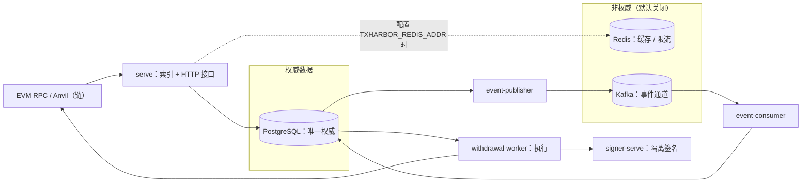

# TxHarbor

EVM / ERC-20 充值、提现与交易基础设施（Go + PostgreSQL），聚焦失败场景下的资金操作正确性：链重组、进程崩溃、交易结果未知、重复请求与事件重复投递。

[功能特性](#功能特性) · [架构](#架构) · [快速开始](#快速开始) · [开发与测试](#开发与测试) · [演示](#演示本地隔离) · [文档](#文档) · [限制与路线图](#限制与路线图) · [许可证](#许可证)

> **项目状态**：开发与验证阶段，**未生产部署**；不维护用户余额账本，不宣称跨系统 Exactly-Once。
> 各层验证状态与已留存证据见 [docs/verification-matrix.md](docs/verification-matrix.md)。

## 功能特性

- **充值索引与重组恢复** —— 连续高度同步、白名单 ERC-20 日志索引、按确认深度判定充值确认；
  链重组时回溯共同祖先、失效旧分叉并重索引受影响充值；恢复过程可崩溃续跑且重复执行幂等。
- **提现接收与异步执行** —— 接收与执行分离：请求路径只做认证、逐笔授权与幂等持久化；构造、
  签名、广播与回执校验由异步 `withdrawal-worker` 完成；完成态仍保持追踪，以吸收链上修订。
- **Nonce 与交易生命周期** —— 并发安全的 nonce 预留与持久绑定；交易结果未知时按链上事实
  对账收敛、缺口对账补正，而不是按失败重发。
- **隔离签名** —— 私钥只存在于独立 `signer-serve` 进程；签名策略上限缺失即拒绝启动，
  `production` 模式无外部密钥 provider 即拒绝启动。
- **可靠事件投递** —— 事务性 Outbox 与业务状态同事务写入，至少一次投递叠加消费幂等
  （去重、版本守卫、有界重试、隔离与人工重放）。
- **对账与备份恢复** —— 链事实 / PostgreSQL 业务状态 / 事件消费结果三路对账；备份恢复按
  能力分级放行（`recovery-admin`）。

机制、状态机与设计取舍见 [docs/architecture.md](docs/architecture.md)。

## 架构



- **充值索引**：`链 → serve（连续高度同步 / 日志索引 / 确认判定）→ PostgreSQL`；重组恢复在
  同一租约循环内完成。
- **提现执行**：`serve（接收与准入）→ PostgreSQL → withdrawal-worker → signer-serve（签名）→ 链`；
  请求路径不执行不可逆动作。
- **事件投递**：`PostgreSQL（Outbox）→ event-publisher → Kafka → event-consumer → PostgreSQL`；
  Redis 只承载缓存与限流（默认关闭），**不在事件投递链上**。
- **PostgreSQL 是唯一权威状态源**；Redis / Kafka 非权威，故障不改变资金事实。
- **Signer 信任边界**：私钥只在 `signer-serve`（独立进程与独立监听器，默认 `127.0.0.1:8091`），
  签名结果经 HTTP 返回业务进程；这是**进程级隔离，不构成网络隔离或数据库权限隔离**（见「限制」）。
- **启动门禁 fail-closed**：必填配置缺失、迁移版本未知 / 未应用、链 id 不匹配 → 拒绝启动；
  索引流的冻结配置身份不一致 → 拒绝扫描并非零退出；**从不自动迁移**。
- **限流失败策略**：限流拒绝 → `429` 可重试（带 `Retry-After`）；限流不可用（Redis 故障）时
  仅新提现创建 `503` 可重试拒绝，其余路径按各自原门禁继续。

| 进程 | 子命令 | 职责 |
| --- | --- | --- |
| 业务进程 | `serve` | 索引流与重组恢复（单租约循环 + 心跳）；提现接收与 nonce 只读接口、执行准入、`/livez` `/readyz` `/metrics` |
| 签名进程 | `signer-serve` | 独立监听器（默认 `127.0.0.1:8091`）；`development` 加载本地密钥文件，`production` 无 provider 即拒绝启动 |
| 执行进程 | `withdrawal-worker` | 领取 / 续租、交易生命周期与 Signer 调用、状态投影与恢复追踪 |
| 事件进程 | `event-publisher` / `event-consumer` | 事务性 Outbox 至少一次发布；幂等消费（inbox 去重 / 版本守卫 / 隔离与重放） |

管理 CLI（`migrate` / `apikey-auth` / `withdrawal-authz` / `signer-auth` / `nonce-admin` /
`withdrawal-exec` / `events-admin` / `reconcile-admin` / `recovery-admin` 等）承载迁移与受控
运维（授权供给 / 撤销、重放、恢复核验与放行）。

**技术栈**（版本以 `go.mod` / `compose.yaml` 为准）：

| 组件 | 版本 | 用途 |
| --- | --- | --- |
| Go | 1.26.5 | 单一二进制、多子命令 |
| PostgreSQL | `postgres:18.6-trixie` | 唯一权威数据源（goose 迁移 embed 进二进制） |
| go-ethereum | v1.17.5 | EVM 类型、RPC 与签名工具 |
| franz-go（+ kadm） | v1.22.0 / v1.19.0 | Kafka 客户端（显式建 topic，auto-create 关闭） |
| go-redis | v9.22.0 | 非权威缓存 / 限流载体 |
| Prometheus client_golang | v1.24.1 | `/metrics` 指标 |
| Testcontainers-go | v0.44.0 | 集成测试中间件（postgres / redis / kafka 模块） |
| Anvil（foundry） | `v1.8.1` | 本地链（`127.0.0.1:8545`，chain-id 31337） |

本地中间件镜像另有 `redis:8.2.10-alpine` / `apache/kafka:4.1.0`（仅 `events` profile，非权威）。

## 快速开始

以下命令从**仓库根目录**执行。

依赖：Go 1.26.5（`go.mod`）、Docker + Docker Compose；bash / zsh（Linux、macOS 或 WSL2）；
`make smoke-quickstart` 另需 `curl`（健康探针）。

```bash
cp .env.example .env          # serve 必填键已生效；signer / worker / 事件键按需取消注释
set -a; source .env; set +a   # 按需修改后加载

docker compose up -d                 # PostgreSQL(127.0.0.1:5432) + Anvil(127.0.0.1:8545)
go run ./cmd/txharbor migrate up     # 应用全部迁移（embed 在二进制）；serve 不会自动迁移
go run ./cmd/txharbor migrate status # 查看迁移状态（current_version / pending）
```

启动业务进程（**长运行进程，在当前终端前台保持运行**）：

```bash
go run ./cmd/txharbor serve          # 默认监听 127.0.0.1:8080
```

**另开一个终端**执行健康检查：

```bash
curl -fsS http://127.0.0.1:8080/livez    # {"status":"alive"}
curl -fsS http://127.0.0.1:8080/readyz   # db / rpc / version / chain 检查
curl -fsS http://127.0.0.1:8080/metrics  # Prometheus 指标（txharbor_* 系列）
```

> `.env.example` 中的资产 / 观察地址（`TXHARBOR_LOG_CONTRACTS` / `TXHARBOR_DEPOSIT_CONTRACTS` /
> `TXHARBOR_DEPOSIT_WATCH_ADDRESSES`）为**占位值**；以上步骤只启动索引服务与健康检查，
> **不部署代币、不会自动完成充值或提现**。完整真实充提演示见[演示](#演示本地隔离)。

必填配置与可选组件：

- `serve`：模板已包含全部必填键（基础配置 + `TXHARBOR_REORG_MAX_DEPTH`，均为可用的开发值）；
  缺任一项即拒绝启动（fail-closed）。
- `signer-serve`：模板已登记 9 个签名策略键（链 / 发送方 / 资产 / 收款方 / 金额与 gas 费用上限）
  与 `MODE`（默认 `production`；无 KMS/HSM provider 即拒绝启动，`development` 模式另需
  `KEY_FILE`）；运行该进程时取消注释并填入真实值。
- `withdrawal-worker`：模板已登记 `TXHARBOR_TX_SIGNER_URL` / `TXHARBOR_TX_SIGNER_CREDENTIAL`
  （凭据由 `signer-auth` 签发后填入）；运行该进程时取消注释。
- 事件通道：`docker compose --profile events up -d` + `TXHARBOR_EVENTS_ENABLED=true`
  （启用时必填键见配置参考）；Signer 隔离叠加：`compose.009.yaml`；恢复 CLI 需独立控制库与
  主体配置（见 [docs/configuration.md](docs/configuration.md) §7）。
- 逐键说明与默认值见 [docs/configuration.md](docs/configuration.md)。

冷启动（`compose up` → `migrate up` → `serve` → 健康端点 / 指标）由 `make smoke-quickstart`
在隔离环境（独立 Compose 项目、端口与数据卷；仅用模板环境）验证，脚本见
`scripts/quickstart-smoke/`。

## 开发与测试

| 入口 | 用途 | Docker |
| --- | --- | --- |
| `make test` / `make test-race` | 单元测试 / race 检测 | 否 |
| `make test-contract` | 事件信封、目录、schema 版本与消费者兼容契约（含对账 / 恢复契约） | 否 |
| `make test-integration` | PostgreSQL 层集成（testcontainers） | 是 |
| `make test-integration-redis` / `make test-integration-kafka` | Redis / Kafka 层集成 | 是 |
| `make test-e2e` | 核心充提全链（全栈 + Anvil） | 是 |
| `make test-fault` / `make test-perf` | 故障注入矩阵 / 性能对照测量（独立层，不进普通 PR） | 是 |
| `make test-drill` | 灾备演练（独立通道；需真实 PG / Anvil，事件场景需 Kafka、宿主 `pg_dump` / `pg_restore`） | 是 |
| `make smoke-quickstart` | Quick Start 冷启动冒烟（隔离环境；不参与普通 PR CI） | 是 |
| `make lint` / `make build` | gofmt + vet（双标签）/ 构建 | 否 |

> ⚠️ **`make db-reset` 会删除数据**（等价 `docker compose down -v`，移除 PostgreSQL 数据卷且不可
> 恢复）——与测试命令分开使用，勿在需要保留数据的栈上执行。

- 各层已留存状态、证据索引与失败披露见 [docs/verification-matrix.md](docs/verification-matrix.md)；
  缺少对应构建标签测试时，分层入口报告 **NOT RUN** 并非零退出（不空跑通过）。
- CI：[Actions](https://github.com/xtianxx/TxHarbor/actions) —— 普通 PR 分层门禁 + 独立通道
  fault-perf / drill（`.github/workflows/`）。

### 演示（本地隔离）

[`scripts/portfolio-demo/run_demo.sh`](scripts/portfolio-demo/run_demo.sh) 在一次性 Compose
项目内演示本地 Anvil 上的真实充值确认、隔离签名提现与幂等重放。使用说明与负例演练见
[scripts/portfolio-demo/README.md](scripts/portfolio-demo/README.md)，讲解见
[docs/portfolio.md](docs/portfolio.md)。历史脱敏证据见
[docs/evidence/portfolio-demo/run04w-20261011130031/](docs/evidence/portfolio-demo/run04w-20261011130031/README.md)：
它是一次历史运行的记录，**不代表当前 HEAD 已复跑**。

> **资金风险**：演示只在本地区块链（Anvil）与一次性测试代币、测试密钥上执行，用于验证代码
> 路径；**不要**将演示中的密钥、地址或流程用于真实资产。

## 文档

| 主题 | 文档 |
| --- | --- |
| 架构与设计 | [docs/architecture.md](docs/architecture.md) —— 组件 / 生命周期图、PostgreSQL 权威设计、Signer 边界、Outbox / Inbox 语义、恢复与对账、设计取舍 |
| 配置参考 | [docs/configuration.md](docs/configuration.md) —— 全部 env 键与默认值、管理 CLI 配置（§7）；模板：`.env.example`、`compose.yaml`、`compose.009.yaml` |
| 验证与证据 | [docs/verification-matrix.md](docs/verification-matrix.md) —— 分层验证矩阵与证据索引；`docs/evidence/` —— 证据归档；`docs/changes/` —— 变更记录 |
| 备份与恢复 | [docs/ops/recovery-runbook.md](docs/ops/recovery-runbook.md) —— 备份 / 恢复 / 核验 / 放行操作 |
| 规格 | `specs/` —— 各阶段规格与 ADR（spec / plan / tasks / data-model / contracts / ADR） |
| 展示材料 | [docs/portfolio.md](docs/portfolio.md) —— 集中演示讲稿与面试要点 |
| 变更与第三方 | [CHANGELOG.md](CHANGELOG.md) —— 变更记录；[THIRD_PARTY.md](THIRD_PARTY.md) —— 依赖与许可说明 |

**仓库结构**：

```
cmd/txharbor/            单一二进制入口（子命令 dispatch）
internal/                业务实现（充值索引 / 提现与执行 / nonce / 签名 / 事件 / 对账 / 恢复等域）
migrations/              goose 迁移（embed 进二进制）
specs/                   各阶段规格（spec / plan / tasks / data-model / contracts / ADR）
docs/                    architecture / configuration / verification-matrix / ops / evidence / portfolio
scripts/                 测量、演练与冒烟工具；portfolio-demo/ 本地真实充提演示
.github/workflows/       ci.yml（PR + main 分层门禁）、fault-perf.yml、drill.yml（独立通道）
```

## 限制与路线图

**限制**：

- **未生产部署**：不宣称 production-ready；生产门禁（KMS/HSM provider、TLS 终止、生产阈值
  裁决）尚未关闭。
- **不维护用户余额账本**：资金事实来自链上观察与请求 / 执行状态。
- **不宣称跨系统 Exactly-Once**：事件投递语义为「至少一次 + 消费幂等」。
- **无生产 KMS/HSM**：v1 仅本地 `development` 密钥 provider，`production` 模式拒绝启动。
- **无应用内 TLS，无 Dockerfile**：明文监听需前置终止；Go 进程在宿主运行。
- **数据库权限未隔离**：`serve` / `signer-serve` / `withdrawal-worker` 共用同一业务 DSN
  （无角色隔离；恢复 CLI 另用独立控制库）。
- **生产阈值与 SLO 未确定**：容量 / 限流 / 告警 / 追赶窗口与备份恢复 RPO/RTO 等均为本地
  测试输入，待裁决。

**路线图（未实施）**：

1. 生产化门禁：KMS/HSM provider、TLS 终止方案与生产阈值裁决；
2. 独立通道（Fault / Perf / Drill）与冷启动冒烟的常规运行与证据归档维护。

## 许可证

许可证待定：仓库暂无独立 LICENSE 文件；依赖与许可说明见 [THIRD_PARTY.md](THIRD_PARTY.md)。
