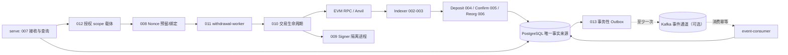

# TxHarbor 展示材料（简历作品 · 集中版）

> **事实边界（先读）**：本材料只描述已提交的实现与已归档的证据。
> 不声称性能提升、不声称查询缓存已启用、不维护余额账本、未生产上线、无生产 SLO；
> 未部署（T000-P 保持 OPEN）。性能相关内容一律写「测量、定位」。
> **两类验证分开读**：(a) 旧的**全套测试命令**（`make test-integration` / `test-e2e` /
> `test-fault` / `test-drill`）在本次材料整理中**未执行**，其能力与历史归档见 §5 补充索引，
> 不因本材料重述而变成「本轮已验证」；(b) **本次真实隔离演示运行**
> `run04w-20261011130031` 已在本地完成：A/B/N5 与最终 verify 全部通过、公开证据扫描通过、
> 退出与清理码为 0，精选证据包见
> [`docs/evidence/portfolio-demo/run04w-20261011130031/`](evidence/portfolio-demo/run04w-20261011130031/README.md)。
> 二者**不可互相替代**：演示运行不覆盖链重组恢复、五态故障矩阵或演练套件。
> CI 诚实性：main 推送 CI 首次失败、同 SHA 单次重试成功，**原因尚未确认**，不声称根因已修复。

## 1. 30 秒项目介绍

**解决什么问题**：EVM 充值/提现基础设施的「正确性」问题——链重组、进程崩溃、重复投递、
交易结果未知、私钥隔离，任何一个处理错误都会造成资金差错；项目把这些失败场景当作一等公民
来设计和验证。

**技术栈**：Go 1.26 单二进制多子命令（serve / signer-serve / withdrawal-worker /
event-publisher / event-consumer + 管理 CLI）；PostgreSQL 18.6 唯一事实来源；Anvil（foundry
v1.8.1）本地链；可选 events profile（Redis/Kafka，非权威）；Prometheus `/metrics`、
`/livez`、`/readyz`；testcontainers 集成测试；无 KMS/HSM、无 TLS、无 Dockerfile（进程在宿主运行）。

**核心能力**：充值链 002–006（连续高度同步 → 白名单 ERC-20 日志索引 → 充值观察 → 确认深度 →
重组恢复）；提现链 007–012（受认证接收与逐笔授权 → nonce 预留/绑定 → 隔离签名 → 交易生命周期
→ 执行 worker 与恢复追踪）；013 可靠事件（事务性 Outbox、至少一次投递 + 消费幂等、五态故障
矩阵、容量保护与恢复追赶）；015 备份恢复安全续跑；证据工程（测量批次、原始归档 + 清单/指纹、
独立复算与 review 闭合）。

## 2. 简明架构与 5 分钟演示讲稿

### 2.1 架构（角色与数据流）

- 单一 Go 二进制、多进程角色；PostgreSQL 是唯一事实来源，不存在 Redis/Kafka 财务状态。
- 不可逆资金动作不在 HTTP 处理器内执行；私钥只存在于 Signer 进程。
- Redis 仅非权威用途（缓存 / fail-closed 限流，013）；与 Kafka 一样仅在 013 events profile 下按需启用，
  本材料不声称其已启用。默认 PG-only 基线（PG + Anvil）不启动发布器/消费者。

### 2.2 五分钟讲稿（基于真实隔离运行 `run04w-20261011130031` 的证据）

> **口径**：「约 5 分钟」指**预备完成后的讲解**（镜像/工具/fixture 已就绪、栈已热）；
> **不承诺冷启动**——本次实测 132 秒（UTC `13:01:02Z → 13:03:14Z`）是这套脚本在**本机已预备**
> 环境下的墙钟时间，不是任何环境的上限或承诺。以下每一步都对应**已归档的原始证据文件**
> （相对链接指向 [`docs/evidence/portfolio-demo/run04w-20261011130031/`](evidence/portfolio-demo/run04w-20261011130031/README.md)）。
> 本节**不代跑命令**，也不声称其他机器已复现。

**0:00–0:40 价值与架构（1 张图）**
问题一句话：EVM 充提的「正确性」——重组、崩溃、重复投递、交易结果未知、私钥隔离。
讲 §2.1 图：PostgreSQL 是唯一事实来源；不可逆资金动作不在 HTTP 处理器内；私钥只存在于
signer 进程。

**0:40–1:40 充值 A：真实链上交易 → Pending → N-1 仍 Pending → N=3 Confirmed**
- [`sql/deposit-pending.out`](evidence/portfolio-demo/run04w-20261011130031/sql/deposit-pending.out)
  （8 字段：`status|block_number|confirm_tip_number|confirm_tip_hash|confirmations|threshold|policy_seq|confirmed_at`，后段空）。
- [`sql/deposit-depth-n1.out`](evidence/portfolio-demo/run04w-20261011130031/sql/deposit-depth-n1.out)
  ——深度 `N-1` **仍 pending**；**注意第 4 字段是 `confirm_tip_hash`（确认尖端），不是充值 tx 的
  block hash**，后者在回执与 run 内 DB 断言中。
- [`sql/deposit-confirmed.out`](evidence/portfolio-demo/run04w-20261011130031/sql/deposit-confirmed.out)
  ——`confirmed|4|6|…|3|3|1`（确认数≥阈值=3、`policy_seq=1`）。
- 链上回执
  [`chain/deposit-receipt.json`](evidence/portfolio-demo/run04w-20261011130031/chain/deposit-receipt.json)；
  链侧余额对账见
  [`chain/final-state.txt`](evidence/portfolio-demo/run04w-20261011130031/chain/final-state.txt)。

**1:40–3:00 提现 B：真实签名付款 + 唯一付款证明（raw topic 查询）**
- 创建 201
  [`http/create-201.json`](evidence/portfolio-demo/run04w-20261011130031/http/create-201.json)
  （`wr-…`）→ 准入 201
  [`http/admit-201.json`](evidence/portfolio-demo/run04w-20261011130031/http/admit-201.json)
  （`intent-portfolio-1`）。
- 真实 signer 签名 + worker 广播上链完成：付款回执
  [`chain/signing-receipt.json`](evidence/portfolio-demo/run04w-20261011130031/chain/signing-receipt.json)。
- **唯一付款证明**：查询口径
  [`chain/transfer-log-query.filter.txt`](evidence/portfolio-demo/run04w-20261011130031/chain/transfer-log-query.filter.txt)
  （`from_block=0`、`to_block=9` 固定 head、token、**topic0/topic1/topic2 为 32-byte raw topic**，
  非事件签名）；原始 JSON
  [`chain/transfer-log-query.json`](evidence/portfolio-demo/run04w-20261011130031/chain/transfer-log-query.json)
  ——**恰 1 条**，`data`=1000e18、`removed`=JSON 布尔 `false`、
  `txhash/blockhash/blocknumber/logindex` 与 signing receipt 的**同一 log** 逐项一致。
- 双向余额与 `totalSupply` 守恒：`chain/final-state.txt`。

**3:00–4:10 重放与有界稳定：不重复的证明**
- 未完重放 200 同 `intent_id`
  [`http/admit-200-unfinished.json`](evidence/portfolio-demo/run04w-20261011130031/http/admit-200-unfinished.json)；
  完成态重放 200 同 `intent_id`
  [`http/admit-200-replay.json`](evidence/portfolio-demo/run04w-20261011130031/http/admit-200-replay.json)；
  创建重放 200 同 `request_id`
  [`http/create-200-replay.json`](evidence/portfolio-demo/run04w-20261011130031/http/create-200-replay.json)。
- 计数不变（重放前后逐字节相同）：
  [`sql/b-counts-before-replay.out`](evidence/portfolio-demo/run04w-20261011130031/sql/b-counts-before-replay.out) /
  [`sql/b-counts-after-replay.out`](evidence/portfolio-demo/run04w-20261011130031/sql/b-counts-after-replay.out)
  = `1|1|1|6`。
- 30s 有界窗口 + 停 worker 后快照**逐字节相同**：
  [`sql/b-window-before.out`](evidence/portfolio-demo/run04w-20261011130031/sql/b-window-before.out) /
  [`sql/b-window-after.out`](evidence/portfolio-demo/run04w-20261011130031/sql/b-window-after.out) /
  [`sql/b-window-after-stop.out`](evidence/portfolio-demo/run04w-20261011130031/sql/b-window-after-stop.out)
  = `1|1|1|1|3|1000000000000000000000|1`。口径：窗口只界定**观察范围**，不是对未来行为的保证。

**4:10–5:00 拒绝、授权与边界**
- N5 负例（均不误增）：无 bearer → 401
  [`http/admit-401.json`](evidence/portfolio-demo/run04w-20261011130031/http/admit-401.json)；
  `can_execute=false` → 403
  [`http/admit-403.json`](evidence/portfolio-demo/run04w-20261011130031/http/admit-403.json)；
  同 key 异额 → 409
  [`http/create-409.json`](evidence/portfolio-demo/run04w-20261011130031/http/create-409.json)。
- 授权与身份：**同一逻辑 caller（7001）**持有请求与授权行、且是 signer 凭据的认证主体（009 将
  授权读取限定在已认证 `caller_id`，异主授权按 `authorization_invalid` 拒绝）；但**秘密相互独立**：
  API key / issuer key / signer 凭据为三份独立 0600 凭据，worker 只注入 signer 凭据，issuer
  保持独立身份（9001）。
- **唯一受控 SQL 例外**：`withdrawal_authorization_scopes` 一行（`request_id` 服务端铸造，无 CLI
  路径可绑定）——因此**不是**「纯 CLI 闭环」；其余配置（调用方/密钥/权限/nonce 注册/上游授权）
  全部走既有管理 CLI，业务事实（请求/意图/绑定/签名/广播/链效应）全部来自真实生产路径。
- Outbox：[`sql/b-outbox-aggregate-versions.out`](evidence/portfolio-demo/run04w-20261011130031/sql/b-outbox-aggregate-versions.out)
  （3 行）= 事务性**写入**，**不是**事件投递（本演示不运行 events pipeline）。
- 收尾：`exit_code=0`、`cleanup_rc=0`；本轮容器/卷/网络**停止保留、无删除**（保留规则见 §2.3）。

### 2.3 复现入口（本轮未执行；不保证其他机器已复现）

一切以仓库现有入口为准：**[`scripts/portfolio-demo/README.md`](../scripts/portfolio-demo/README.md)**。

- 实际命令：`bash scripts/portfolio-demo/run_demo.sh`（`run_all`：preflight → setup → A → B → verify）；
  `--preflight-only` 只做守卫检查；新 run 用新 `PORTFOLIO_RUN_ID`。
- 必要预置：`bash 5`、`curl`、`go`、`timeout`、Docker CLI + Compose v2（≥2.24.4）、**本地 unix
  docker context**（`DOCKER_HOST`/`DOCKER_TLS_VERIFY`/`DOCKER_CERT_PATH` 未设、不导出
  `TXHARBOR_RPC_URL`）、端口 `55436/58547/18081/18091` 空闲、一次性编译 fixture
  （`compile_token.sh --fetch/--compile/--verify`，固定 solc 0.8.30 到隔离工具目录）。
- 固定本地镜像与保留策略：compose project `txharbor-demo-<run-id>`；退出只**停止**自有进程与
  双标签（project + run_token）容器，**从不删除**任何容器/卷/网络；清理需另行授权。
- 时间口径：脚本自带的 A/B/verify 断言与 `public/` 证据是复现判据；**不要引用未实测的耗时**。

## 3. 三条简历要点（可直接复制）

1. **真实运行闭环（本地隔离，2026-10-11 实测）**：同一次运行内完成真实 ERC-20 充值
   （Pending → 深度 `N-1` 仍 Pending → `N=3` Confirmed，SQL 快照与链上回执互证）与真实提现
   （201 创建/准入 → **隔离 signer 进程签名** + worker 广播上链 → 同 caller/同 idempotency_key
   重放 200 且请求/意图/绑定/链效应不重复 → 30s 有界窗口与停 worker 后快照逐字节稳定）；
   唯一付款用 **raw 32-byte topic** 的 `eth_getLogs` 证明（恰 1 条，字段与回执同一 log 一致），
   逐层幂等与 nonce/fencing 由计数与快照断言。
2. **正确性设计**：以 PostgreSQL UNIQUE 约束而非应用层检查保证幂等；状态迁移全部显式化、
   不可逆资金动作移出 HTTP 处理器；充值链按 canonical 链处理重组（共同祖先 → 旧分叉失效 →
   重索引重算），提现链以「nonce 预留/持久绑定 → 隔离签名 → 结果未知对账」闭环。
3. **故障恢复与证据测量**：崩溃点与重启场景集成测试（硬杀子进程）、租约/心跳、持久化暂停与
   恢复续跑；`make test-drill` 全量演练 S1–S12/F1–F7 由 JSON 检查器逐项校验，缺失或跳过即失败
   （NOT RUN 纪律）；自建测量接缝（`perf` 标签，普通构建 no-op）+ 串行批次 + 原始归档
   （`SHA256SUMS`、采集时源码指纹）+ 独立复算与 review 闭合（审计工具回归 17/17、runner
   批次根保护夹具 8/8）；性能只做**测量与定位**（如尾窗覆盖 99.93%、`process` 占 tail
   99.09–99.28%），不写未实现的性能提升。

**写这三条时不要越界**：不写生产级/百万吞吐/SLO/性能提升/账本入账/跨系统恰好一次；
本次运行**未**证明全栈事件投递或链重组恢复（不运行 events pipeline、不做重组演练）。
补三句限定：①授权存在**一行受控 SQL 例外**（`withdrawal_authorization_scopes`），不是纯 CLI 闭环；
②同一逻辑 caller（7001）持有请求与授权，但 API key / issuer key / signer 凭据**三份秘密独立**、
issuer 独立（9001）；③`Confirmed` 是索引确认状态、**不是记账/入账**；Outbox 6 行全
`publish_state=pending` 是**写入不是投递**；`tx_attempts=1` 仅该 run 的诊断口径。

## 4. 五个核心面试问答

**Q1｜为什么 PostgreSQL 是唯一事实来源，Redis/Kafka 不承载财务状态？**
幂等与并发正确性靠数据库约束（UNIQUE）与事务保证，缓存/队列只做非权威加速与投递；
Redis 限流为 fail-closed（PD-1），Kafka 仅承载事件（至少一次）。这样任何缓存/队列故障
都不会改变资金事实，恢复只需回到 PG。

**Q2｜链重组如何保证充值正确？**
以 canonical 链为准：检测分叉后在配置最大深度内找共同祖先，旧分叉失效、受影响充值转
Orphaned，随后重新索引/识别/计算确认；恢复状态持久化、重复执行幂等、可崩溃续跑
（006；阈值版本化与重判见 005）。已知边界：仅配置深度内的重组有保证，生产阈值待校准。

**Q3｜提现如何做到私钥隔离与「结果未知」处置？**
009 独立进程持钥，业务进程只拿签名结果；`production` 模式无 KMS/HSM provider 时
fail-closed 拒绝启动（v1 限制：无 KMS/HSM、无 TLS，生产需自行前置）。008 预留并持久绑定
nonce；010 处理同字节重播、费用替换、回执与预期 Transfer 验证；对账处置未知结果。

**Q4｜事件基础设施为何是「至少一次 + 消费幂等」而不是恰好一次？**
事务性 Outbox 把业务状态与事件写入同一事务，跨系统「恰好一次」需要分布式协调、代价与
故障面更大；选择至少一次 + 消费端幂等（inbox 去重）把复杂度放在可验证的一侧，
**不宣称跨系统恰好一次**；重组会产生修订事件，由消费者幂等吸收。

**Q5｜性能工作如何「测量与定位」而不夸大？**
`perf` 标签接缝（普通构建零逻辑）+ ON/OFF 同接缝配对（只衡量细分采集增量）+ 串行批次与
原始归档；用尾窗裁剪与嵌套关系把 tail 分解到 `process`→`tx_total`→7 条语句链
（覆盖 99.93%、`process` 99.09–99.28%、语句链占 `tx_total` 98.8%）。局限：单机、n≤4、
顺序/漂移不可分解，pristine 两书挡不能分解测点开销；结论不构成 SLO。
证据诚实性包含 CI：main 推送首次失败（PostgreSQL 层
`TestRestoreInterruptionNotRestoredAndRerunIdempotent`）、同 SHA 单次重试成功，
**原因尚未确认**。

## 5. 证据与入口索引（可定位）

- **本次真实运行（run04w）**：精选证据包
  [`docs/evidence/portfolio-demo/run04w-20261011130031/`](evidence/portfolio-demo/run04w-20261011130031/README.md)
  （22 个原始字节复制 + `PROVENANCE.md` 来源/哈希对照 + `SHA256SUMS`）；完整原始树（含
  `private/`）留在本地 git-ignored `.evidence/portfolio-demo/run04w-20261011130031/`，
  执行时 HEAD `11d698c…`（**不是**收录本证据包的那次文档提交）；变更记录见
  [`docs/changes/portfolio-demo.md`](changes/portfolio-demo.md) §20。
- **复现入口**：[`scripts/portfolio-demo/README.md`](../scripts/portfolio-demo/README.md)
  （`run_demo.sh` 命令、预置、固定端口、保留策略；本轮未执行、不保证其他机器已复现）。
- **既有全套测试命令（本轮未执行；历史证据见下方补充索引）**：`make test-integration`（002–006
  PostgreSQL 层）、`make test-e2e`（007–011 全栈 + Anvil）、`make test-fault`（五态故障矩阵）、
  `TXHARBOR_DRILL_EVIDENCE_DIR=<dir> make test-drill`（S1–S12 + F1–F7，JSON 检查器逐场景 PASS，
  缺失/跳过即失败，**NOT RUN 不允许冒充通过**）。

**补充索引（既有证据）**：

- **源码**：`internal/events/consumer.go`（观测接缝 + 消费循环）、`scripts/consumerseg/run_batch.sh`、
  `scripts/consumerseg/analyze/`、`internal/txlifecycle/crash_integration_test.go`、
  `internal/recovery/backup_integration_test.go`、`internal/signer/`、`internal/nonce/`。
- **演练/恢复**：`docs/ops/recovery-runbook.md`、`Makefile`（`test-drill` 目标与 NOT RUN 纪律）、
  `scripts/drillcoverage/check.go`、`docs/evidence/015/`、`docs/evidence/015-fix-drill-runner-modcache/`。
- **性能诊断**：`docs/evidence/013-supplement/consumer-seg/README.md`（口径与结论）、
  `docs/evidence/013-supplement/consumer-seg/CORRECTIONS.md`（review #1–#8 与 P2 闭合）、
  `docs/evidence/013-supplement/consumer-seg/analysis/summary.md`（派生统计）、
  `docs/evidence/013-supplement/consumer-seg/checks/`（本轮核验日志与可重跑审计脚本）、
  `docs/evidence/019-normal-query-seg/`（对照批次）。
- **013 证据索引**：`docs/evidence/013/quickstart_evidence_index.md`（实现经 PR #25 进入 main；
  未部署，容量/限流/追赶阈值待测/待裁决）。
- **CI**：PR #44 运行 [37745833563](https://github.com/xtianxx/TxHarbor/actions/runs/37745833563)（success）；
  main 推送运行 [37748375307](https://github.com/xtianxx/TxHarbor/actions/runs/37748375307)
  （attempt 1 failure → attempt 2 success；原始日志与元数据留存于本地 git-ignored 审计目录
  `.evidence/ci-runs/verify/013-consumer-seg-pr44/`）。
